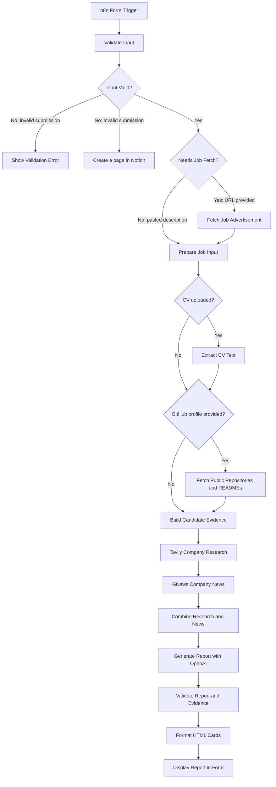

# Project 3 MVP - Interview Prep Report

Interview Prep Report helps job seekers prepare for an upcoming interview by turning a job posting and their professional background into a personalized preparation report.

## The problem

Preparing for an interview means researching the company, understanding what the role requires, and figuring out which parts of your experience to emphasize. Pulling that information together can be time-consuming.

## MVP

Submit the n8n form with:

- The company name
- The job description pasted into the job-posting field, or a public job-posting URL entered in that same field
- At least one candidate source: a PDF CV or a GitHub username/profile URL

The workflow uses these details to create a role-specific report.

## What the report includes

The form displays a styled HTML report with:

1. **Company background** - a brief introduction to the company.
2. **Recent relevant news** - zero to three news items, when available.
3. **Role requirements** - intended to contain up to five requirements and their priority.
4. **Your match** - intended to contain up to three candidate-experience matches.
5. **Projects to highlight** - intended to contain up to two relevant projects.
6. **Skill gaps to address** - intended to contain up to three gaps with preparation steps.
7. **Likely interview questions** - exactly five questions.

The report-generation prompt targets about 500 words, but the workflow does not enforce a word count or guarantee that the rendered report fits on one page. Exactly five interview questions and no more than three news items are enforced during validation. The other section limits above are requested by the prompt but are not independently enforced by the workflow. News items are linked in the HTML report. Company source URLs and candidate evidence references are validated during processing but are not currently displayed as links in the report.

## Typical Workflow

Open the n8n form
-> Enter the company and job posting
-> Upload a PDF CV, provide a GitHub profile, or both
-> Submit the form
-> Review the report displayed by the form

## Workflow

Form submission
-> Validate inputs
-> Fetch and parse the job posting when a URL was entered
-> Extract CV text and/or collect public GitHub repository evidence
-> Research the company with Tavily and GNews
-> Generate and validate the report
-> Format the report as HTML cards and display it in the form

Invalid input is displayed in the form. The invalid-input branch is also connected to a Notion node that attempts to create a validation-error page.

## Setup

### Requirements

- An n8n instance, either n8n Cloud or a self-hosted n8n installation.
- Credentials for Tavily, GNews, and OpenAI.
- An optional Notion credential and destination page if validation-error logging is enabled.
- A browser for opening the n8n form.

### Installation and configuration

1. Start or open an n8n instance. If self-hosting, install n8n using the installation method supported by your deployment environment.
2. Copy `.env.example` to `.env` only if your n8n deployment uses environment variables for configuration. Keep the values in `.env` local and private.
3. Import [FINAL_n8n-mvp-workflow.json](./FINAL_n8n-mvp-workflow.json).
4. Configure and assign credentials to the Tavily, GNews, and OpenAI nodes in n8n. The workflow uses n8n credential references; it does not read project-level `.env` values directly.
5. Check the Notion node's credential and target page/database configuration if you want to keep validation-error logging enabled.
6. Reassign credentials after importing if n8n does not preserve them.
7. Activate the workflow before using its production form URL. The imported workflow is inactive by default.
8. Never put real API keys in the workflow JSON, README, `.env.example`, screenshots, or Git commits.

The workflow export contains n8n credential references, but not API key or token values. Its Notion node uses a page-ID placeholder for validation-error logging; replace it with a page you control before running that node.

### Environment variables

`.env.example` contains variable names only. The current workflow does not reference project-level environment variables directly; these names are provided for deployments that map secrets into n8n or use them when configuring credentials. Do not commit `.env` or real secret values.

The workflow does not currently use NewsAPI, Pinecone, or an authenticated GitHub token. GitHub requests use public unauthenticated endpoints.

## File Map

| File or folder | Purpose |
|---|---|
| `FINAL_n8n-mvp-workflow.json` | Primary n8n MVP workflow to import and run. |
| `README.md` | Project overview, setup, usage, architecture, testing, and limitations. |
| `.env.example` | Safe template containing environment-variable names only. |
| `.env` | Local environment configuration; ignored by Git and must never contain committed secrets. |
| `report_template.md` | Reference for the intended interview-report structure and content. |
| `stack_decision.md` | Records technology and architecture decisions. |
| `gtm_future_sprints.md` | Future product, go-to-market, and development ideas. |
| `visual_proof` | Folder containing Form-interface.png, Report-1.png, Report-2.png,final-n8n-workflow.png screenshots showing the form, generated reports, and workflow layout. |

## Architecture

`Input Valid?` sends invalid submissions to both `Show Validation Error` and `Create a page` in Notion; these are parallel branches. Missing a company name, job posting, or both candidate sources (PDF CV and GitHub profile) makes the submission invalid, so it does not reach `Needs Job Fetch?`. For a valid submission, `Needs Job Fetch?` is true only when a job URL is present and no pasted description is present; otherwise the workflow proceeds directly to `Prepare Job Input`.

When a job URL is entered, `Prepare Job Input` first looks for structured `JobPosting` JSON-LD and then falls back to the page's `og:description` metadata. If neither provides enough text, the workflow reports an error and asks the user to paste the job description instead.

GitHub evidence is retrieved without a GitHub credential from public repositories; forked repositories are excluded from the final candidate evidence. The workflow requests up to 30 repositories, sorted by recent push activity, and retrieves repository metadata and README content. Candidate CV text is capped at 30,000 characters and each README is capped at 12,000 characters. The report is generated as structured JSON internally, validated, then formatted as HTML for display; the form does not return a JSON API response.

The workflow's validation code guarantees the required report sections, exactly five interview questions, and no more than three news items. It removes unverified source links and candidate claims, but it does not independently enforce every maximum requested by the generation prompt.

## Tech Stack and Why

| Technology | Purpose |
|---|---|
| n8n Form Trigger and Form nodes | Collect input and display validation errors or the completed report |
| n8n Code nodes | Validate input, combine evidence, validate the generated report, and render HTML |
| OpenAI `gpt-4o-mini` | Generates the structured interview preparation report |
| Tavily Search API | Retrieves company research |
| GNews API | Retrieves company news |
| GitHub REST API | Retrieves public repository metadata and README content |
| n8n Extract From File | Extracts text from PDF CVs |
| Notion node | Attempts to log invalid form submissions; it does not store generated reports |

### External tools and APIs

The MVP depends on four external services:

- **OpenAI API** — generates the structured interview-preparation report.
- **Tavily Search API** — provides company research.
- **GNews API** — provides recent company news.
- **GitHub REST API** — provides public repository metadata and README evidence.

n8n, PDF extraction, and the optional Notion node support orchestration, candidate processing, and validation logging; they are not used as research or report-generation APIs.

## How to Run

1. Import the workflow and configure its credentials as described above.
2. Activate the workflow and open the production form URL shown by n8n. During development, use the form's test URL.
3. Enter the company name.
4. Paste the job description into **Job post**, or enter a complete public `http(s)` job-posting URL in that field.
5. Upload a PDF CV, enter a GitHub username/profile URL, or provide both.
6. Submit the form and review the generated report on the completion screen.

The workflow validates that the company name and job posting are provided and that at least one candidate source (PDF CV or GitHub profile) is available. The GitHub field accepts a username or a GitHub profile URL.

## Testing Checklist

- [ ] Import the workflow and assign all required API credentials.
- [ ] Confirm the Tavily, GNews, and OpenAI credentials work.
- [ ] Submit a pasted job description.
- [ ] Submit a publicly accessible job-posting URL.
- [ ] Test with a PDF CV only.
- [ ] Test with a public GitHub profile only.
- [ ] Test with both a PDF CV and GitHub profile.
- [ ] Test a missing company name or job posting.
- [ ] Test a submission with neither a CV nor a GitHub profile.
- [ ] Test an invalid GitHub username/profile URL.
- [ ] Test a valid GitHub profile with no public non-fork repositories.
- [ ] Test a non-PDF upload.
- [ ] Test a PDF that uploads but contains no extractable text.
- [ ] Test an inaccessible or JavaScript-only job page.
- [ ] Test a job page without usable `JobPosting` JSON-LD or `og:description` metadata.
- [ ] Test failed or rate-limited Tavily, GNews, OpenAI, and GitHub requests.
- [ ] Confirm the form displays all seven report sections and exactly five interview questions.
- [ ] Confirm unsupported candidate claims are removed by `Validate Report`.
- [ ] Confirm the invalid-input form message is shown and, if configured, logged to the intended Notion destination.

## Limitations and Error Handling

- Job URLs must be publicly accessible and readable without an interactive login.
- JavaScript-rendered, bot-protected, or blocked job pages may fail. Paste the job description when URL extraction fails.
- URL extraction relies on structured `JobPosting` data or `og:description` metadata. The workflow processes at most 500,000 characters of fetched HTML and caps the extracted job description at 20,000 characters.
- Scanned PDFs may produce little or no extractable text because OCR is not included. If the extracted CV text is shorter than 50 characters, the CV is ignored; the workflow fails later if no usable GitHub evidence remains.
- GitHub evidence is limited to public, non-fork repositories retrieved through unauthenticated GitHub API requests. The request can return up to 30 repositories and may be affected by GitHub rate limits.
- The report may contain zero to three news items when relevant news cannot be verified.
- The report is displayed as HTML; PDF export and email delivery are not implemented.
- The workflow does not currently use Pinecone, RAG, LinkedIn, or persistent storage for generated reports.
- Invalid input is displayed in the form, and the connected Notion node attempts to create a validation-error page. Review its credential and destination; disable or reconfigure the node if this logging is not desired.
- Later failures—such as an unreadable job page, no usable candidate evidence, or an API/credential error—may terminate the n8n execution instead of returning a friendly form message. Review the n8n execution log for these failures.
- Candidate claims are checked against supplied CV text or GitHub repository evidence. The report currently does not display candidate evidence URLs or company background source URLs, although those sources are checked during validation. News URLs are displayed as links in the report.
- The OpenAI and research requests do not have a general fallback report path; transient API failures may require a retry or rerun.

## Security and Privacy

- Store Tavily, GNews, OpenAI, and (if used) Notion credentials in n8n credentials or environment variables.
- Never place API keys in the workflow JSON, README, screenshots, or Git commits.
- Keep `.env` excluded from version control.
- Rotate any key that has been exposed.
- Treat CVs, candidate context, and profile data as personal information.
- Use synthetic test data before processing real candidate information.
- Review n8n execution-history retention and delete sensitive executions when appropriate.
- The invalid-input branch may retain validation messages in Notion; verify the destination and retention policy before using real submissions.
- Define how submitted CVs and candidate data are retained and deleted before inviting real users.
- Avoid exposing the form publicly without appropriate access controls and rate limits.

## Intended Outcome

Help job seekers focus their preparation on the company, the role, and the strongest relevant examples from their own experience.

## Success Metrics

| Metric | How to measure | Example target |
|---|---|---|
| Required-section completeness | Percentage of reports containing every required section | 100% |
| Question relevance | Check that each question relates to the role, company, or candidate | At least 4 of 5 questions |
| Source validation | Check that company/news URLs in generated data match the research results; news links are visible in the report | 100% of returned URLs verified |
| Report conciseness | Review rendered report length and readability; one-page fit is not guaranteed | About 500 words |
| News item formatting | When news is included, check that each item has a date and source link | Every displayed item has a date and link |
| Experience fit | Check candidate experience and project claims against the supplied CV or public repository evidence | 100% supported; no unsupported claims |
| Autonomous completion | Count valid submissions that finish without human intervention after submission | 5 of 5 test runs |

## Demo & Presentation

Links to be added
