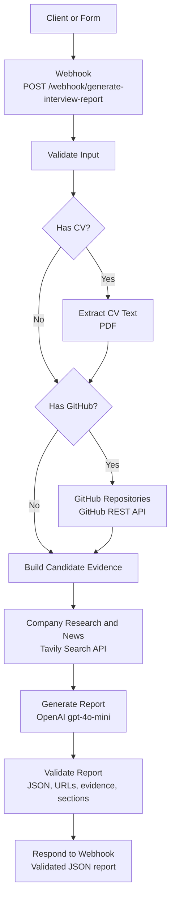

# Project 3 MVP - Interview Prep Report

Interview Prep Report helps job seekers prepare for an upcoming interview by turning a job posting and their professional background into a personalized, one-page preparation brief.

## The problem

Preparing for an interview means researching the company, understanding what the role requires, and figuring out which parts of your experience to emphasize. When an interview is only a week away, pulling all of that together can be time-consuming.

## MVP

Provide:

- The company name
- Either a link to the job advertisement or the job description text
- One or more sources for your background: a GitHub profile, CV file, or the candidate context or background text

The MVP uses these details to create a concise report tailored to the role and your experience.

## What the report includes

Each report is designed to fit on one page and covers:

1. **Company background** — a brief introduction to the company.
2. **Recent relevant news** — the two or three most recent news items related to the role, when available.
3. **Role requirements** — the main skills, experience, and responsibilities described in the job posting.
4. **Your match** — how your experience and projects relate to the role, based on the profile or CV you provided.
5. **Projects to highlight** — projects that are especially useful to discuss in the interview.
6. **Skill gaps to address** — requirements that appear less represented in your background, with suggestions for how to prepare.
7. **Likely interview questions** — five questions tailored to the role and your experience.

## Typical Workflow

Enter company and job details
→ Provide candidate evidence
→ Submit the request
→ Receive the interview preparation report

## Workflow

Receive request
→ Validate inputs
→ Collect candidate evidence
→ Research company and news
→ Generate report
→ Validate report
→ Return result

## Setup

(to be edited)

## Architecture

    The MVP is implemented as an n8n workflow exposed through a POST webhook. The workflow validates the company, job, and candidate inputs; optionally extracts text from a PDF CV; optionally retrieves public GitHub repositories; researches the company and recent role-related news through Tavily; and sends the collected information to OpenAI to generate a structured interview preparation report. A final validation step checks the report structure, source URLs, candidate evidence, and required question count before returning the report as JSON.

## Tech Stack and Why

| Technology | Purpose |
|---|---|
| n8n | Orchestrates the workflow and exposes the webhook |
| n8n Code nodes | Validate inputs, combine evidence, and validate the generated report |
| OpenAI `gpt-4o-mini` | Generates the structured interview preparation report |
| Tavily Search API | Retrieves company information and recent relevant news |
| GitHub REST API | Retrieves public repository information |
| n8n Extract From File | Extracts text from PDF CVs |
| Webhook response | Returns the final report as JSON |

## How to Run

(to be edited)

## Intended outcome

Help job seekers focus their preparation on the company, the role, and the strongest relevant examples from their own experience.

## Success Metrics

| Metric | How to measure | Example target |
|---|---|---|
| Required-section completeness | Percentage of reports containing every required section | 100% |
| Question relevance | Check that each question relates to the role, company, or candidate | At least 4 of 5 questions |
| Source support | Check that each company claim is supported by a cited source link | 100% of claims |
| One-page fit | Render reports with a consistent template and count pages | 100% fit on one page |
| News item formatting | When news is included, check that there are 2–3 items and each has a date and source link | 2–3 items, each with a date and link |
| Source link validity | Automatically check whether cited links resolve | At least 95% resolve successfully |
| Experience fit | Check candidate experience and project claims against the supplied profile or CV | 100% supported; no unsupported claims |
| Autonomous completion | Count runs that finish without human input after a valid submission | 5 of 5 test runs |
