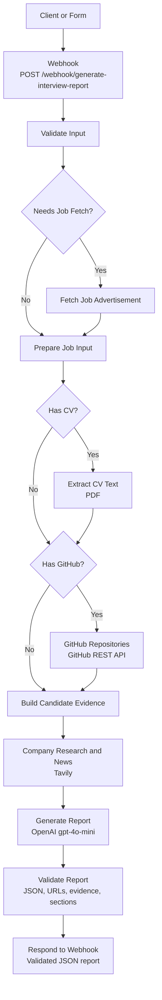

# Project 3 MVP - Interview Prep Report

Interview Prep Report helps job seekers prepare for an upcoming interview by turning a job posting and their professional background into a personalized, one-page preparation brief.

## The problem

Preparing for an interview means researching the company, understanding what the role requires, and figuring out which parts of your experience to emphasize. When an interview is only a week away, pulling all of that together can be time-consuming.

## MVP

Provide:

- The company name
- Either a link to the job advertisement or the job description text
- One or more sources for your background: a GitHub profile, CV file, or the candidate context or background text

The MVP uses these details to create a concise report tailored to the role and your experience.

## What the report includes

Each report is designed to fit on one page and covers:

1. **Company background** — a brief introduction to the company.
2. **Recent relevant news** — the two or three most recent news items related to the role, when available.
3. **Role requirements** — the main skills, experience, and responsibilities described in the job posting.
4. **Your match** — how your experience and projects relate to the role, based on the profile or CV you provided.
5. **Projects to highlight** — projects that are especially useful to discuss in the interview.
6. **Skill gaps to address** — requirements that appear less represented in your background, with suggestions for how to prepare.
7. **Likely interview questions** — five questions tailored to the role and your experience.

## Typical Workflow

Enter company and job details
→ Provide candidate evidence
→ Submit the request
→ Receive the interview preparation report

## Workflow

Receive request
→ Validate inputs
→ Collect candidate evidence
→ Research company and news
→ Generate report
→ Validate report
→ Return result

## Setup

1. Open an n8n instance.
2. Import n8n-workflow json file (to be added)
3. Create or assign an HTTP Header Auth credential for Tavily.
4. Create or assign an OpenAI credential for the OpenAI API.
5. Reassign credentials after importing if n8n does not preserve them.
6. Keep API keys in n8n credentials or environment variables, never in the workflow JSON.


## Architecture



The workflow is implemented in n8n. It validates the request, accepts either pasted job-description text or a public job-advertisement URL, collects candidate evidence from a PDF CV, candidate context, or GitHub, researches the company through Tavily, generates the report with OpenAI, validates the result, and returns JSON.

When a job URL is provided, `Prepare Job Input` first looks for structured `JobPosting` JSON-LD and then falls back to the page's `og:description` metadata. If neither contains enough text, the workflow asks the user to paste the job description instead.

## Tech Stack and Why

| Technology | Purpose |
|---|---|
| n8n | Orchestrates the workflow and exposes the webhook |
| n8n Code nodes | Validate inputs, combine evidence, and validate the generated report |
| OpenAI `gpt-4o-mini` | Generates the structured interview preparation report |
| Tavily Search API | Retrieves company information and recent relevant news |
| GitHub REST API | Retrieves public repository information |
| n8n Extract From File | Extracts text from PDF CVs |
| Webhook response | Returns the final report as JSON |

## How to Run

1. Start or open n8n.
2. Import n8n-workflow json file (to be added).
3. Assign the Tavily and OpenAI credentials to their respective nodes.
4. Activate the workflow, or use the n8n test webhook while developing.
5. Send a `POST` request to:

```text
/webhook/generate-interview-report
```

The request must include `company_name` and either `job_description` or `job_url`. It must also include at least one candidate source: `candidate_context`, `github_profile`, or a PDF uploaded as the binary field `cv`.

Example JSON request:

```json
{
  "company_name": "Example Company",
  "job_description": "We are looking for a backend developer with API and database experience.",
  "candidate_context": "I have built REST APIs with Node.js and PostgreSQL.",
  "github_profile": "your github profile name"
}
```

The workflow returns the validated report as JSON. If both `job_description` and `job_url` are supplied, the pasted job description is used.

## Testing Checklist

- [ ] Import the workflow successfully.
- [ ] Confirm the Tavily credential works.
- [ ] Confirm the OpenAI credential works.
- [ ] Test with pasted `job_description`.
- [ ] Test with a publicly accessible `job_url`.
- [ ] Test with a candidate context only.
- [ ] Test with a public GitHub profile.
- [ ] Test with a text-based PDF CV using the binary field `cv`.
- [ ] Test a missing company name.
- [ ] Test a request with neither `job_description` nor `job_url`.
- [ ] Test an invalid GitHub URL.
- [ ] Test a non-PDF CV.
- [ ] Test an inaccessible or JavaScript-only job page.
- [ ] Confirm the response contains all required report sections.
- [ ] Confirm unsupported candidate claims are removed by `Validate Report`.

## Limitations and Error Handling

- Job URLs must be publicly accessible and readable without an interactive login.
- JavaScript-rendered, bot-protected, or blocked job pages may fail. Paste the job description when URL extraction fails.
- URL extraction relies on structured `JobPosting` data or `og:description` metadata.
- Scanned PDFs may produce little or no extractable text because OCR is not included.
- GitHub evidence is limited to public repositories.
- The workflow does not currently use Pinecone, RAG, LinkedIn, persistent storage, email delivery, or PDF report generation (to be explored in future versions).
- Invalid input stops the workflow with a validation error.
- Tavily or OpenAI credential and API errors must be reviewed in the n8n execution log.
- Reports may contain zero to three news items when relevant news cannot be verified.
- The final validation step removes claims whose URLs or candidate evidence cannot be traced to the supplied data.

## Security and Privacy

- Store Tavily and OpenAI keys in n8n credentials or environment variables.
- Never place API keys in the workflow JSON, README, screenshots, or Git commits.
- Keep `.env` excluded from version control.
- Rotate any key that has been exposed.
- Treat CVs, candidate context, and profile data as personal information.
- Use synthetic test data before processing real candidate information.
- Review n8n execution-history retention and delete sensitive executions when appropriate.
- Define how submitted CVs and candidate data are retained and deleted before inviting real users.
- Avoid enabling public access to the webhook without appropriate access controls and rate limits.

## Intended outcome

Help job seekers focus their preparation on the company, the role, and the strongest relevant examples from their own experience.

## Success Metrics

| Metric | How to measure | Example target |
|---|---|---|
| Required-section completeness | Percentage of reports containing every required section | 100% |
| Question relevance | Check that each question relates to the role, company, or candidate | At least 4 of 5 questions |
| Source support | Check that each company claim is supported by a cited source link | 100% of claims |
| One-page fit | Render reports with a consistent template and count pages | 100% fit on one page |
| News item formatting | When news is included, check that there are 2–3 items and each has a date and source link | 2–3 items, each with a date and link |
| Source link validity | Automatically check whether cited links resolve | At least 95% resolve successfully |
| Experience fit | Check candidate experience and project claims against the supplied profile or CV | 100% supported; no unsupported claims |
| Autonomous completion | Count runs that finish without human input after a valid submission | 5 of 5 test runs |
